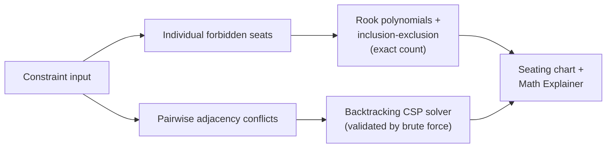
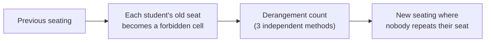
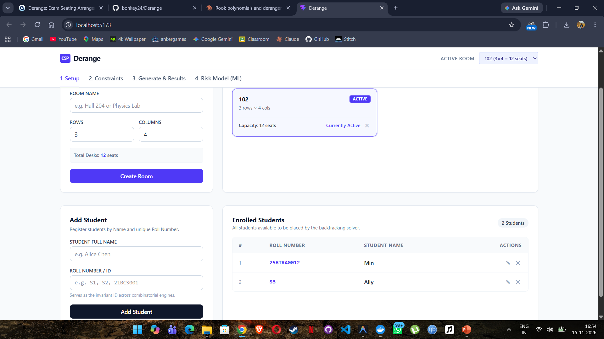
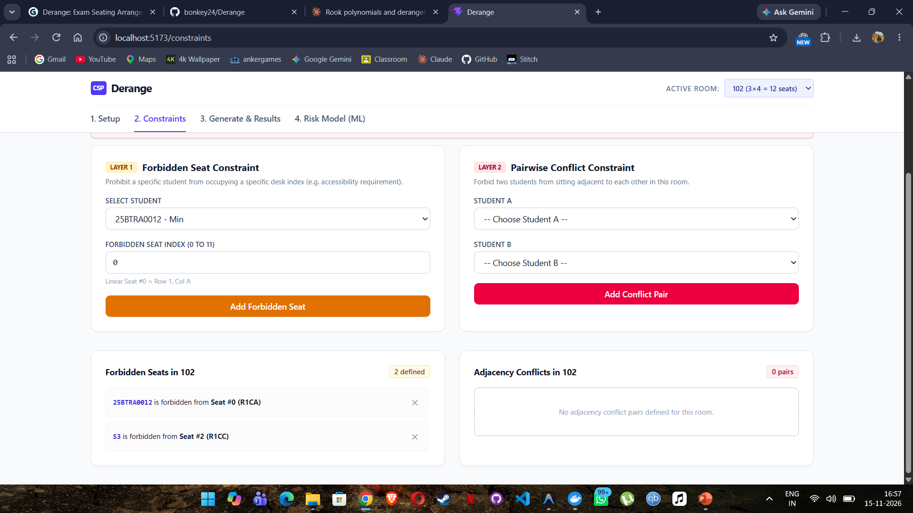
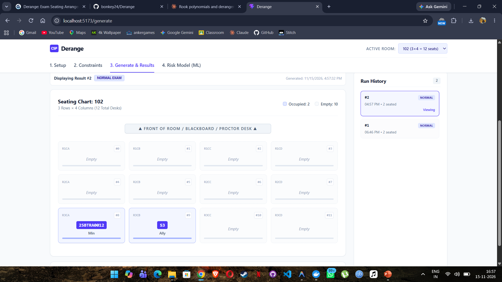
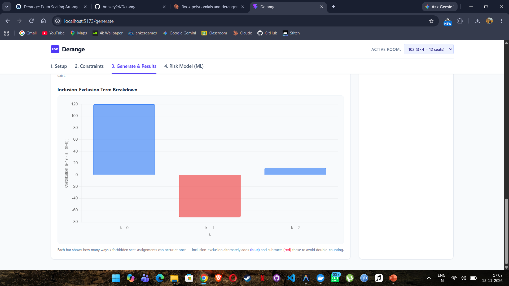
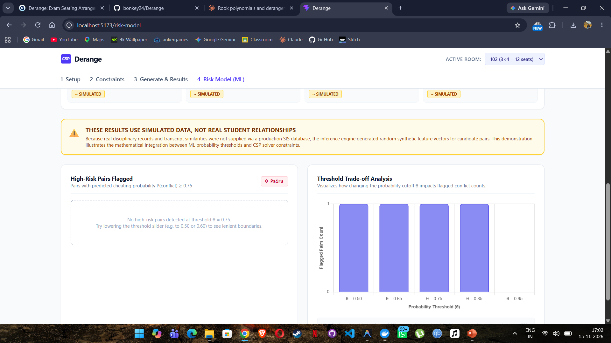

# Derange

**Exam seating, solved with rook polynomials, inclusion-exclusion and derangements.**


---

## Why Derange?

- **Random shuffling is not enough.** It cannot count how many valid layouts exist, and it cannot guarantee that every forbidden seat or adjacency conflict is respected.
- **Retests need mathematical certainty.** When students retake an exam, nobody should sit in their previous seat — a constraint that is exactly a *derangement*, and Derange counts and generates them analytically.
- **Transparency matters.** The app shows every step of the math — rook-polynomial coefficients, inclusion-exclusion terms, derangement counts — so the result can be verified by hand.

---

## The Math at a Glance

| Concept | Role in the app | Formula |
|---------|----------------|---------|
| **Rook polynomial** | Counts ways to place *k* non-attacking rooks on a forbidden-position board (each rook = one student violating a seat ban). Computed by deletion-contraction recursion. | $R(B, x) = \sum_{k=0}^{n} r_k \, x^k$ |
| **Inclusion-exclusion** | Plugs the rook coefficients into the classical forbidden-positions formula to get an **exact** count of valid seatings that avoid all individually-banned seats. | $N_0 = \sum_{k=0}^{n} (-1)^k \, r_k \, (n - k)!$ |
| **Derangements** | The special case where every student is forbidden from their *own* previous seat — used for retest re-seating. | $D_n = n! \sum_{k=0}^{n} \frac{(-1)^k}{k!}$ |
| **Exponential generating function** | Independently verifies the derangement counts via the EGF, cross-checked with `sympy` series expansion. | $D(x) = \frac{e^{-x}}{1 - x}$ |

All three counting methods (recurrence, rook + inclusion-exclusion, generating function) agree exactly for every tested value of *n*:

> $D(4) = 9, \quad D(5) = 44, \quad D(6) = 265$

---

## How It Works

### Constraint → Seating Pipeline



### Retest Re-seating



---

## Screenshots

| Setup | Constraints |
|:-----:|:-----------:|
|  |  |
| *Create rooms and enroll students* | *Define forbidden seats (Layer 1) and adjacency conflicts (Layer 2)* |

| Seating Grid | Math Explainer |
|:------------:|:--------------:|
|  |  |
| *Generated conflict-free seating chart* | *Inclusion-exclusion term breakdown with bar chart* |

| Risk Model (ML) |
|:---------------:|
|  |
| *ML risk model with provenance labels and simulated-data warning* |

---

## Honest ML Layer

A **Random Forest** classifier flags potentially high-risk student pairs, but the project is explicit about what is real and what is not.

| Feature | Source |
|---------|--------|
| `roll_number_proximity` | **Real** — computed from the anonymized class roster CSV (real USN structure). |
| `past_incidents_together` | **Simulated** by default; upgrades to **real** if manual evidence is supplied. |
| `academic_similarity_score` | **Simulated** (no real transcript data). |
| `shared_classes_count` | **Simulated** (all students share an identical subject list in this dataset). |

The system tracks provenance **per feature, per pair** and reports one of three states — `real`, `partial`, or `simulated`. The frontend surfaces this via a **Feature Provenance Matrix** and color-coded honesty banners.

> **This is a decision-support demonstration, not proof of cheating.** A bold yellow warning appears on every run that uses simulated data.

A **`PROTECTED_REAL_NAMES`** safeguard ensures that no real (non-anonymized) student name can ever appear in a flagged ML output, and a **roster mismatch safety check** halts the model if the submitted student list does not match the loaded roster.

---

## Tech Stack

| Layer | Technology | Version |
|-------|-----------|---------|
| Math / ML engine | Python, sympy, numpy, pandas, scikit-learn | 3.13 / 1.14 / 2.5 / 3.0 / 1.9 |
| Backend | Django, Django REST Framework, SQLite (dev) / PostgreSQL (prod) | 6.1 / 3.18 |
| Frontend | React, Vite, Tailwind CSS, Chart.js, React Router | 19 / 8.3 / 4 / 4.5 / 7 |
| Static files | WhiteNoise | 6.12 |
| Containers | Docker, Docker Compose | — |
| Testing | pytest, pytest-django, oxlint | 9.1 / 4.14 / 1.81 |

---

## Quick Start

### Option A — Local development

```bash
# Install all dependencies (backend + frontend)
npm run install:all

# Start both servers (Django on :8000, Vite on :5173)
npm run dev
```

- **UI:** http://localhost:5173
- **API:** http://127.0.0.1:8000/api/

### Option B — Docker

```bash
docker compose up --build
```

- **UI:** http://localhost:5173
- **API:** http://127.0.0.1:8000/api/

```bash
docker compose down
```

> **Do not run Docker and `npm run dev` at the same time** — they bind the same ports.

### Environment Variables

#### Backend (`backend/.env` — see `backend/.env.example`)

| Variable | Description | Default |
|----------|-------------|---------|
| `SECRET_KEY` | Django secret key | Dev key (change in production) |
| `DJANGO_DEBUG` | `1` for True, `0` for False | `1` |
| `DJANGO_ALLOWED_HOSTS` | Comma-separated hostnames | `localhost,127.0.0.1` |
| `CORS_ALLOWED_ORIGINS` | Comma-separated origins | `http://localhost:5173,http://127.0.0.1:5173` |
| `DJANGO_DB_PATH` | SQLite file path | `BASE_DIR / 'db.sqlite3'` |
| `DATABASE_URL` | PostgreSQL URL (overrides SQLite) | unset |

#### Frontend (`frontend/.env` — see `frontend/.env.example`)

| Variable | Description | Default |
|----------|-------------|---------|
| `VITE_API_BASE_URL` | Base URL for the Django REST API | `http://127.0.0.1:8000/api` |

---

## API Reference

| Endpoint | Methods | Description |
|----------|---------|-------------|
| `/api/rooms/` | GET, POST | List and create exam rooms |
| `/api/rooms/<id>/` | GET, PATCH, DELETE | Retrieve, update or delete a room |
| `/api/students/` | GET, POST | List and create students |
| `/api/students/<id>/` | GET, PATCH, DELETE | Retrieve, update or delete a student |
| `/api/forbidden-constraints/` | GET, POST | List and create forbidden seat constraints |
| `/api/forbidden-constraints/<id>/` | GET, DELETE | Retrieve or delete a forbidden constraint |
| `/api/conflict-pairs/` | GET, POST | List and create pairwise adjacency conflicts |
| `/api/conflict-pairs/<id>/` | GET, DELETE | Retrieve or delete a conflict pair |
| `/api/generate-seating/` | POST | Generate a conflict-free seating chart for a room |
| `/api/generate-retest/` | POST | Generate a retest seating (derangement of previous arrangement) |
| `/api/train-risk-model/` | POST | Train and score the ML risk model |
| `/api/seating-results/<room_id>/` | GET | Retrieve past seating results for a room |
| `/api/math-explainer/<room_id>/` | GET | Analytical breakdown (rook poly + I-E coefficients) |

---

## Testing

```bash
# Backend — 14 unit tests covering all combinatorial engines
python -m pytest backend/ -q

# Frontend — production build (type-checks + bundle)
npm --prefix frontend run build
```

---

## Deployment

The project is **deployment-ready** for:

- **Backend → [Render](https://render.com)** — Django + PostgreSQL. Set `DATABASE_URL` to the Render-provided connection string; `dj-database-url` parses it automatically. WhiteNoise serves static files without a separate CDN.
- **Frontend → [Vercel](https://vercel.com)** — Static SPA build. A `vercel.json` rewrite rule is included to support React Router's client-side routing.

---

## Roadmap

- [ ] Kubernetes manifests for multi-container orchestration
- [ ] Cloud deployment (Render + Vercel, live demo URL)
- [ ] Integration with real anonymized institutional data
- [ ] Research paper on the rook-polynomial seating approach

---

## Course Context

**Discrete Mathematics and Graph Theory** (25BSMA10)
Jain (Deemed-to-be University) · B.Tech CSE (AI Driven DevOps)
Experiential Learning Project

---

*Built as a Discrete Mathematics course project (Modules I–III: Inclusion-Exclusion, Derangements, Rook Polynomials, Generating Functions), extended with a full-stack implementation and applied ML for portfolio purposes.*
